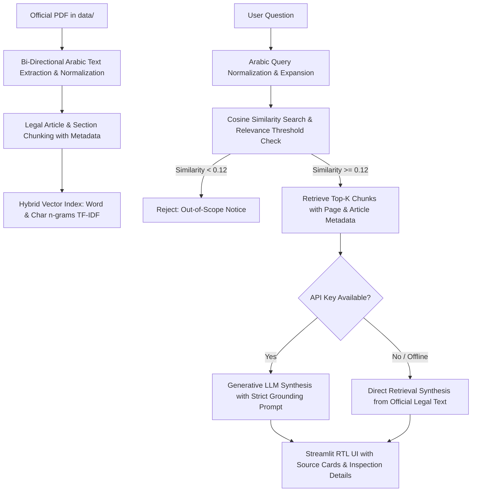

# PDPL Guide AI — Intelligent Assistant for SDAIA DPO Regulations

[](https://www.python.org/)
[](https://streamlit.io/)
[](https://sdaia.gov.sa/)
[](LICENSE)

An intelligent Arabic-first Retrieval-Augmented Generation (RAG) assistant specifically designed to help organizations, legal compliance officers, and data protection officers understand the official document issued by the **Saudi Authority for Data and Artificial Intelligence (SDAIA)**:

> **«قواعد تعيين مسؤول حماية البيانات الشخصية»**  
> *(Rules for Appointing Personal Data Protection Officers - Version 1.0, August 2024)*

The application answers questions grounded strictly in the official PDF text, cites exact article numbers and PDF page numbers, and rejects out-of-scope queries with complete transparency.

---

## 📑 Table of Contents

- [Overview & Objectives](#-overview--objectives)
- [Key Features](#-key-features)
- [RAG Architecture & Workflow](#-rag-architecture--workflow)
- [Technology Stack](#-technology-stack)
- [Project Structure](#-project-structure)
- [Installation & Setup](#-installation--setup)
- [Running the Application](#-running-the-application)
- [Dual Operational Modes](#-dual-operational-modes)
- [Source Citations & Grounding](#-source-citations--grounding)
- [Example Questions for Testing](#-example-questions-for-testing)
- [Limitations & Known Considerations](#-limitations--known-considerations)
- [GitHub Upload Commands](#-github-upload-commands)
- [Legal Disclaimer](#-legal-disclaimer)

---

## 🎯 Overview & Objectives

Saudi Arabia's Personal Data Protection Law (PDPL) and its Executive Regulations require specific controllers to appoint a Data Protection Officer (DPO). SDAIA published the definitive rules establishing:
1. Minimum qualifications and expertise required for DPOs.
2. Mandatory cases and criteria under which appointing a DPO is legally required.
3. Specific duties, roles, and organizational reporting lines for DPOs.

**PDPL Guide AI** bridges the gap between regulatory text and practical understanding by providing instant, cited, and source-grounded answers without hallucinations.

---

## ✨ Key Features

- **Arabic-First Native RTL Interface**: Sleek, professional interface designed specifically for Arabic typography (Cairo and Tajawal Google fonts) with emerald green styling aligned with Saudi national identity.
- **Strict Grounding & Anti-Hallucination**: If the document does not contain adequate evidence or if a question is out of scope (e.g., *"What is the capital of France?"*), the assistant explicitly states:  
  *«لا تتوفر معلومات كافية في الوثيقة للإجابة عن هذا السؤال.»*
- **Exact Legal Citations**: Every response includes dedicated source cards with the Article Number, Article Title, official PDF Page Number, and supporting excerpt.
- **Dual Operational Modes**:
  - **🟢 Generative LLM Mode**: Uses Google Gemini, OpenAI, or Groq to synthesize fluid, grounded Arabic explanations strictly conditioned on retrieved excerpts.
  - **🔵 Authentic Retrieval-Only Mode**: Functions 100% locally and offline without external API keys, presenting structured, highlighted legal text directly from the document.
- **RAG Inspection Details**: An expandable section allows compliance auditors to inspect the retrieved passages, cosine similarity scores, and chunk boundaries.
- **Cross-Lingual Support**: Supports English queries by mapping legal concepts to the corresponding Arabic articles.

---

## 🏗️ RAG Architecture & Workflow

The retrieval pipeline consists of the following stages:



1. **Extraction & Arabic Re-ordering**:
   - Arabic PDF documents often store text in visual (left-to-right) glyph sequences with Unicode Presentation Forms-B.
   - `src/extractor.py` applies the Unicode Bidirectional (bidi) algorithm and NFKC normalization to reconstruct natural logical text, preserving Arabic tanween, tashkeel, and numbers.
2. **Article-Based Chunking**:
   - The document is segmented into 13 legal chunks mapping directly to the official table of contents (Articles 1 through 11, plus the Introduction).
   - Each chunk preserves metadata: `article_number`, `article_title`, `page_number`, `source_doc`, and `summary`.
3. **Hybrid Vector Indexing**:
   - Combines character n-grams (`char_wb` 3-5) and word n-grams (1-2) with TF-IDF weighting to account for Arabic morphology and prefixes (`ال`, `و`, `ب`, `ل`).
   - Domain-specific legal synonyms enrich each chunk to guarantee robust semantic recall.
4. **Out-of-Scope Filtering**:
   - Queries with a maximum similarity score below `RELEVANCE_THRESHOLD` (0.12) are intercepted immediately to prevent hallucinating on unrelated topics.

---

## 💻 Technology Stack

- **Language**: Python 3.11+
- **Web Framework**: Streamlit
- **PDF Extraction**: `pypdf` + `python-bidi` + `unicodedata`
- **Vector Search & Embeddings**: `scikit-learn` (TF-IDF Vector Space, Cosine Similarity) + `numpy`
- **Generative Models (Optional)**: Google Gemini (`gemini-1.5-flash`), OpenAI (`gpt-4o-mini`), Groq (`llama-3.3-70b-versatile`)
- **HTTP Client**: `requests` (clean REST implementation with zero SDK version conflicts)

---

## 📁 Project Structure

```
pdpl-guide-ai/
├── app.py                  # Streamlit application with Arabic RTL UI
├── requirements.txt        # Python project dependencies
├── .gitignore              # Excludes secrets, caches, and virtual environments
├── .env.example            # Environment variables template (no real keys)
├── README.md               # Complete project documentation (English)
├── data/
│   ├── README.md           # Instructions for placing the official PDF
│   └── مشروع+قواعد+تعيين+مسؤول+حماية+البيانات+الشخصية+2.pdf  # Official SDAIA PDF
└── src/
    ├── __init__.py         # Python package marker
    ├── config.py           # Configuration constants, paths, and prompts
    ├── extractor.py        # PDF extraction, Arabic text reconstruction, chunking
    └── rag.py              # Searchable vector index, retrieval, LLM integration
```

---

## 🚀 Installation & Setup

### 1. Clone the Repository
```bash
git clone <YOUR_REPOSITORY_URL>
cd pdpl-guide-ai
```

### 2. Create and Activate a Virtual Environment
```bash
# Windows (PowerShell)
python -m venv venv
.\venv\Scripts\Activate.ps1

# Linux / macOS
python3 -m venv venv
source venv/bin/activate
```

### 3. Install Dependencies
```bash
pip install -r requirements.txt
```

### 4. Configure Environment Variables (Optional)
If you wish to use Generative AI mode, create a `.env` file from the example:
```bash
cp .env.example .env
```
Open `.env` and add your API key:
```ini
GEMINI_API_KEY=your_actual_gemini_api_key_here
```
> **Note:** If you do not configure an API key, the application will run seamlessly in **Retrieval-Only Mode**, displaying authentic official excerpts and source citations without external dependencies.

---

## 🖥️ Running the Application

Launch the Streamlit web interface:
```bash
streamlit run app.py
```

The application will automatically open in your default browser at:
`http://localhost:8501`

---

## 🔄 Dual Operational Modes

| Feature | 🟢 Generative LLM Mode | 🔵 Retrieval-Only Mode |
|---|---|---|
| **API Key Needed?** | Yes (`GEMINI_API_KEY` or `OPENAI_API_KEY`) | **No (100% Offline & Local)** |
| **Response Style** | Natural synthesized Arabic explanation | Structured excerpts of official text |
| **Article Citations** | ✅ Yes (Article & Page) | ✅ Yes (Article & Page) |
| **Passage Inspector** | ✅ Yes | ✅ Yes |
| **Hallucination Risk** | Zero (Strict context conditioning) | Zero (Direct document quotes) |

---

## 📖 Source Citations & Grounding

Every answer provides an interactive citation box including:
- **Article Number & Title**: (e.g., `المادة الرابعة: متطلبات تعيين مسؤول حماية البيانات الشخصية`)
- **Official Page Number**: (e.g., `صفحة 5`)
- **Source Document**: `قواعد تعيين مسؤول حماية البيانات الشخصية`
- **Verbatim Excerpt**: Direct passage extracted from the approved document.

---

## 🧪 Example Questions for Testing

The application includes dedicated quick-test buttons for the 4 benchmark validation questions:

### Test 1: Requirements for Appointing a DPO
- **Query:** `"ما المتطلبات التي يجب توفرها عند تعيين مسؤول حماية البيانات الشخصية؟"`
- **Expected Match:** Article 4 (Page 5).
- **Core Requirements:** Appropriate educational qualification and experience, risk management and data breach expertise, knowledge of statutory requirements, integrity and no moral turpitude convictions.

### Test 2: Mandatory Circumstances for Appointing a DPO
- **Query:** `"ما الحالات التي يجب فيها تعيين مسؤول حماية البيانات الشخصية؟"`
- **Expected Match:** Article 5 (Pages 6–7).
- **Core Circumstances:** Public entity processing personal data on a large scale; core activities requiring regular and systematic monitoring; core activities processing sensitive data.

### Test 3: Duties and Responsibilities of a DPO
- **Query:** `"ما المهام التي يقوم بها مسؤول حماية البيانات الشخصية؟"`
- **Expected Match:** Article 8 (Pages 8–9).
- **Core Duties:** Support and internal policy advice, awareness and training, reviewing breach response plans, periodic compliance reports, monitoring regulatory updates, advising IT development teams.

### Test 4: Out-of-Scope Rejection
- **Query:** `"ما عاصمة فرنسا؟"`
- **Expected Outcome:** Immediate out-of-scope identification.
- **Response:**
  > *"لا تتوفر معلومات كافية في الوثيقة للإجابة عن هذا السؤال. يختص هذا المساعد حصراً بـ «قواعد تعيين مسؤول حماية البيانات الشخصية» الصادرة عن سدايا."*

---

## ⚠️ Limitations & Known Considerations

1. **Document Scope**: The application is strictly bounded to SDAIA's DPO appointment document. Questions about general PDPL provisions outside this document (such as cross-border data transfer regulations or administrative penalties) are acknowledged as outside this document's scope.
2. **PDF Typography**: Arabic PDFs exported with visual glyphs require bidirectional reconstruction, which has been calibrated for this document.
3. **Informational Guidance**: The assistant provides regulatory clarification but does not replace legal counsel.

---
🔗 Try the live demo: https://pdpl-guide-ai.streamlit.app/


## 📤 GitHub Upload Commands

To initialize a Git repository and push this project to GitHub:

```bash
# 1. Initialize git
git init

# 2. Add all project files (ignoring secrets and venv via .gitignore)
git add .

# 3. Create initial commit
git commit -m "feat: initial commit for PDPL Guide AI RAG application"

# 4. Set main branch
git branch -M main

# 5. Add your remote repository URL (replace with your GitHub repository URL)
git remote add origin https://github.com/<YOUR_USERNAME>/<YOUR_REPOSITORY_NAME>.git

# 6. Push to GitHub
git push -u origin main
```

---

## ⚖️ Legal Disclaimer

> **إخلاء مسؤولية:** هذا التطبيق هو أداة استرشادية ذكية مبنية على وثيقة رسمية صادرة عن الهيئة السعودية للبيانات والذكاء الاصطناعي (سدايا). لا يمثل التطبيق رأياً قانونياً رسمياً ولا يقدم تدقيق امتثال نهائي، ولا يغني عن الرجوع إلى الجهة المختصة أو الاستشارات القانونية المرخصة.
